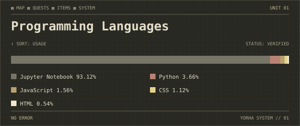

# Welcome to my profile (❁´◡`❁)

I'm Himadri, a BSc Statistics and Data Science student.

Currently in my 1st Year, learning how to code and do statistics. 

**Future goals and ideas:**
+ Machine Learning
+ Explore an interdisciplinary field where I combine Statistics with another subject of my liking
+ Research
+ Explore and build new things
+ Learn Linux (started already)
  
My favourite thing is to explore new stuff and build more things

**Fun Fact about me:**
+ I own a cat.
+ I like mountains.
+ I play a lot of JRPGs and story games (My favourite game is Like a Dragon).
+ Hobbies: taking long walks, badminton, rock hounding and photography.
  
"Learning something new every day"

**My socials**
- [My Steam ID](https://steamcommunity.com/id/DragonLordHimadri/)
- Discord Username: dragonlordhimadri

---

## ⬡ YoRHa SYSTEM — LANGUAGE ANALYSIS

<picture>
  <source
    media="(prefers-color-scheme: dark)"
    srcset="assets/languages-dark.svg"
  />
  <source
    media="(prefers-color-scheme: light)"
    srcset="assets/languages-light.svg"
  />
  
</picture>

